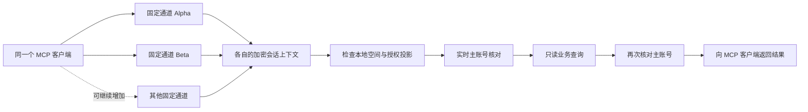

<div align="center">

# Accio Multi-Store MCP

**将本地 Accio 的店铺会话接成独立、固定身份的只读 MCP 通道。**

Read-only MCP channels for multiple stores, bound to existing Accio conversations.

[](https://github.com/alan113523/accio-multi-store-mcp/actions/workflows/ci.yml)
[](LICENSE)


[快速开始](#快速开始) · [工具能力](#工具能力) · [工作方式](#工作方式) · [验证范围](#验证范围) · [原项目与致谢](#原项目与致谢)

</div>

## 它解决什么问题

把多家已授权店铺分别绑定到自己的 MCP 进程，在同一 MCP 客户端中调用不同店铺。
通道复用 Accio 已有会话的店铺绑定和请求上下文，每次经营查询前后核对实际主账号身份。
店铺数量由本机配置决定，不依赖界面列表顺序，也不把同一登录凭据的多个副本当作店铺隔离。

- **固定店铺**：进程启动时指定通道别名，工具参数不能切换目标。
- **实时核对**：通过 `subaccount_query` 校验平台返回的主账号 AliId。
- **可退出浏览器**：无需保留 Accio 网页；本地 Accio 桌面客户端仍需保持登录运行。
- **只读入口**：身份、员工经营汇总和类目元数据；使用固定工具白名单。
- **异常即停止**：授权、空间、快照或身份变化时拒绝调用，不回退到当前默认店铺。

> 当前为 Windows 实验性适配。使用 Accio 客户端的内部会话接口，尚无官方第三方兼容承诺。
> 本项目独立于 Accio / Alibaba.com；需要自行安装客户端并具备相应店铺授权。

## 工具能力

| MCP 工具 | 上游调用 | 用途与边界 |
| --- | --- | --- |
| `identity` | `subaccount_query` | 查询并核对主账号；返回经过筛选的身份信息 |
| `account_summary` | `data_advisor_account_summary` | 按时间范围查询员工经营效果，调用前后核对主账号 |
| `publishing_categories` | `query_user_category` | 只读类目元数据；不能据此证明实际发品权限或可发布类目范围 |

不提供商品创建、保存草稿、正式发布、广告修改、订单写入或授权管理。

## 快速开始

### 1. 环境准备

Windows、Node.js 22+、PowerShell **7.4+** 和 pnpm 10。
本地需要已登录的 Accio Work，以及各目标店铺已绑定的现有会话。
开发验证环境使用 Node.js 24 和 Accio Work 0.35.2；其他客户端版本需要重新核验。

```powershell
git clone https://github.com/alan113523/accio-multi-store-mcp.git
cd accio-multi-store-mcp
pnpm install --frozen-lockfile --ignore-scripts
New-Item -ItemType Directory -Path .local -Force
Copy-Item examples/stores.example.json .local/stores.json
```

### 2. 填写本机映射

编辑 `.local/stores.json`，替换全部占位符。示例店铺完全虚构，可增减条目：

| 字段 | 含义 |
| --- | --- |
| 条目键，如 `shop_alpha` | 供 MCP 进程使用的本机通道别名 |
| `label` | 自定义显示名称 |
| `loginId` | 已授权店铺的真实登录标识，必须与 Accio 授权及会话 `storeIdentity` 一致 |
| `name` | 已有店铺会话的精确名称；同名匹配必须唯一 |
| `aliId` | 预期主账号 AliId，必须由本人核对，不能依据标签或列表顺序猜测 |

名称相似不能作为身份依据；每个目标的登录标识、会话名称和主账号应各自唯一。
本工具读取现有会话，不创建会话或修改绑定。占位符配置会被拒绝。

### 3. 固定上下文

```powershell
node channel.mjs init
node channel.mjs capture
node channel.mjs status shop_alpha
```

`init` 核对已有会话与授权映射，写入私有绑定清单；`capture` 保存 Windows 当前用户
DPAPI 加密的上下文及受限工具目录。它们不会创建新的 Token/Cookie 文件。
首次绑定时若旧会话引用已经失效，仅允许依据一致的 `storeIdentity`、登录标识和 AliId
匹配当前授权；后续运行中发现授权引用变化即停止。

上述步骤只建立本机绑定；还需执行 `identity` 核对真实平台身份：

```powershell
node channel.mjs call shop_alpha subaccount_query '{}'
```

### 4. 接入 MCP 客户端

将 [examples/mcp.example.json](examples/mcp.example.json) 的绝对路径改为实际位置，
每个店铺配置一个独立 `server.mjs <通道别名>` 进程。
Codex 示例见 [examples/codex.example.toml](examples/codex.example.toml)，
配置格式参见 [Codex MCP 官方文档](https://learn.chatgpt.com/docs/extend/mcp?surface=cli)。
客户端可能需要刷新或重启后才能显示新工具。

调用 `account_summary` 的参数示例：

```json
{
  "accountQueryParam": {
    "startDate": "2026-01-01",
    "endDate": "2026-01-02",
    "statisticsType": "day"
  }
}
```

`statisticsType` 仅接受 `day`、`week`、`month`；不接受额外店铺或授权参数。
若使用网络代理，MCP 客户端需显式继承已有代理环境变量，避免子进程丢失网络配置。
示例配置仅列出变量名，不包含代理地址、密码或其他真实值。

## 工作方式



本地 gateway 提供已授权账号与会话映射；业务请求使用固定的原生代理封装。
凭据由标明来源的上游读取函数在 PowerShell 子进程内使用，Node/MCP 不接收原始 Token。
上下文包含连接、会话及 Agent 引用；仅更换本机配置文件名不足以隔离店铺。

| 环境变量 | 默认值 / 用途 |
| --- | --- |
| `ACCIO_CHANNEL_STATE_DIR` | 项目下 `.local/`，存放运行状态 |
| `ACCIO_CHANNEL_CONFIG` | 状态目录下 `stores.json`，私有店铺映射 |
| `ACCIO_HOME` | 当前用户的 `.accio/`，本地 gateway 状态根目录 |
| `ACCIO_PWSH` | `pwsh`，可指定 PowerShell 7.4+ 的完整路径 |

自定义路径应放在仓库外。凭据仍读取当前 Windows 用户标准应用数据目录。
详见 [安全与隐私](SECURITY.md)。

## 验证范围

| 项目 | 当前结论 |
| --- | --- |
| 原本机实现的多店身份、经营汇总与类目元数据 | 曾完成授权环境中的只读实测；原始数据保留在本机 |
| 独立浏览器退出后的调用 | 原本机实现曾完成检查；需要本地 Accio 持续运行 |
| 本公开版本的配置化、错误处理、MCP stdio 和 DPAPI | 由仓库中的离线合成测试验证 |
| 本公开版本的真实商家联通 | 配置化发布后未重新进行；不等同于原本机版本实测 |
| 关闭 Accio、自动重绑定、长期重启稳定性、发品写入 | 未验证 / 未实现 |

公开仓库不包含真实店铺数量、身份、业务指标、会话引用、日志或测试截图。
离线测试不会登录真实平台，不能替代使用者自己的店铺身份与只读验收。
建议接入后按 **Alpha → Beta → 其他通道 → Alpha** 查询，逐次核对实时身份。
日期以平台返回值为准，不能将响应日期静默改写为请求日期。

```powershell
pnpm check
pnpm test
```

测试详情及本机实测的证据边界见 [docs/VALIDATION.md](docs/VALIDATION.md)。

## 常见问题

**找不到 `pwsh`**：安装 PowerShell 7.4+ 并加入 PATH，或设置 `ACCIO_PWSH`。

**`STORE_CONFIG_UNAVAILABLE`**：检查 `.local/stores.json` 或自定义配置路径。

**`STORE_AUTHORIZATION_NOT_UNIQUE_OR_UNAVAILABLE`**：检查 Accio 登录、当前空间及目标授权。

**`ENCRYPTED_CONTEXT_REQUIRED`**：先完成 `init` 和 `capture`。

**`CURRENT_AUTHORIZATION_REFERENCE_CHANGED` / `LIVE_SELLER_IDENTITY_MISMATCH`**：
停止使用该通道，在 Accio 中核对授权与目标身份。确认变化后，保留旧私有状态作本机备份，
使用新的状态目录显式重建绑定；运行时不会自动改店。

**业务查询失败或返回空内容**：视为失败，检查客户端版本和授权，不能解释为零业务数据。

## 原项目与致谢

本项目复用 [MeGustas-5427/accio-alibaba-data-advisor](https://github.com/MeGustas-5427/accio-alibaba-data-advisor)
的凭据读取、有效期检查及结果脱敏函数，保留 **MeGustas-5427** 的 MIT 版权及许可证。
多店固定会话上下文、实时身份保护与 MCP 通道封装为本项目适配内容。

MCP 传输使用官方 [TypeScript SDK](https://github.com/modelcontextprotocol/typescript-sdk)。
页面组织参考 [Best-README-Template](https://github.com/othneildrew/Best-README-Template)
和 [apify/mcpc](https://github.com/apify/mcpc)，未复制其页面资产。

完整来源、固定修订及许可证范围见 [THIRD_PARTY_NOTICES.md](THIRD_PARTY_NOTICES.md)。
本项目新增代码采用 [MIT License](LICENSE)。欢迎按 [CONTRIBUTING.md](CONTRIBUTING.md) 提交改进。
